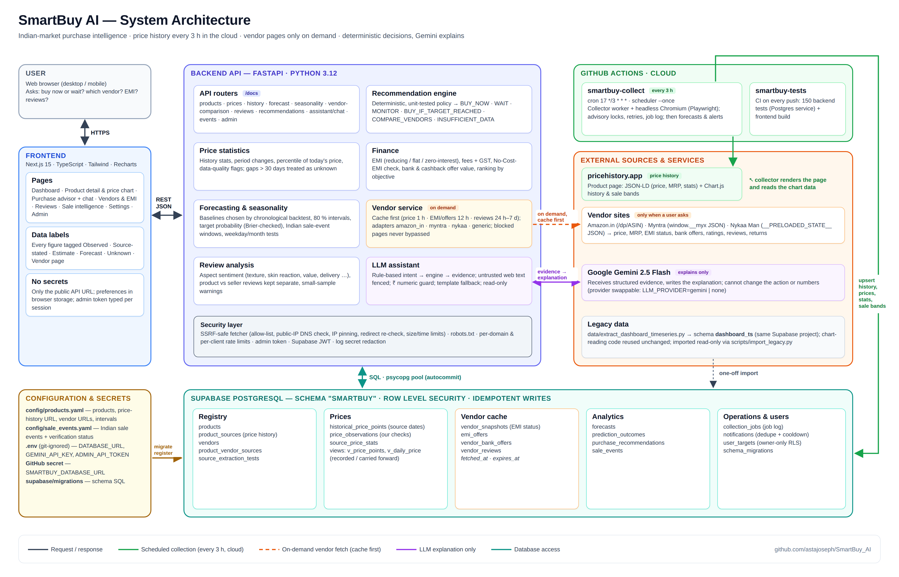

# SmartBuy AI — Indian Market Purchase Intelligence

SmartBuy AI helps a shopper decide **buy now, wait, or monitor** for a tracked product, using real
recorded prices, Indian sale-event history, on-demand vendor/EMI comparison, review analysis, and a
Gemini-powered assistant that *explains* (never invents) the result.

> **Tracking:** the [progress tracker](#2-progress-tracker) below shows what is done and what is pending.
> The full, dated history of every change (what, why, files, tests) is in [`docs/WORKLOG.md`](docs/WORKLOG.md).



---

## 1. How the system works (the workflow)

```
                ┌────────────────────── scheduled (every 3 h) ──────────────────────┐
config/products.yaml ─► registry ─► price_history source URL ─► extraction adapter ─► Supabase
   (products + URLs)                (e.g. pricehistory.app)      (JSON-LD + chart)      historical_price_points
                                                                                         price_observations
                                                                                         sale_events (chart bands)
                ┌──────────────── only when a user asks (cache first) ───────────────┐
User question ─► assistant ─► recommendation engine ─► needs EMI/vendor/reviews? ─► vendor_service
                     │              │  (deterministic policy)        │ no: vendor pages untouched
                     │              ▼                                ▼ yes: cached? else fetch vendor URL
                     │       history stats · forecast ·        emi_offers / vendor_reviews / vendor_snapshots
                     │       seasonality · EMI maths                (fetched_at + expires_at)
                     ▼
               Gemini explains the structured result (numeric guard rejects invented ₹ amounts)
```

1. **Register** products in `config/products.yaml` — one *price-history URL* per product plus any
   number of *vendor URLs*. No code change is needed to add products or vendors.
2. **Collect** — the scheduler (`app/workers/scheduler.py`, run by GitHub Actions every 3 h) visits only
   the price-history URLs, on each product's interval (180 min for product 1). It stores the source's historical chart points with
   their original dates, the current price/offer price with our own observation timestamp, the
   source's stated lowest/average/highest/MRP, and sale windows drawn on the chart.
3. **Analyse** — history statistics with data-quality flags, baseline forecasts validated by
   chronological backtests, Indian sale-event windows, weekday/month patterns (only claimed when a
   statistical test and enough data support them).
4. **Recommend** — a tested rule-based policy returns `BUY_NOW / WAIT / MONITOR /
   BUY_IF_TARGET_REACHED / COMPARE_VENDORS / INSUFFICIENT_DATA` with reasons, risks, confidence and
   limitations.
5. **Vendor / EMI / reviews on demand** — only when the user asks; cached with TTLs (EMI 12 h,
   vendor price 1 h, review aggregates 24 h, samples 7 d); expired offers are never shown as live;
   stale cache is labelled with its timestamp.
6. **Explain** — Gemini receives the structured evidence (with web-page text fenced off as untrusted)
   and writes the explanation. If it mentions a ₹ amount not in the evidence, the answer is replaced
   by a template explanation.
7. **Evaluate** — stored forecasts are scored against later recorded prices (`prediction_outcomes`).

## 2. Progress tracker

_Last updated: 2026-10-23._

### Done

| # | Date | Milestone | Verified by |
|---|---|---|---|
| 1 | 2026-10-16 | Inspected the repo, existing `dashboard_ts` data and pricehistory.app; planned a separate `smartbuy` schema | source test script |
| 2 | 2026-10-16 | Supabase schema + RLS migrations, product / sale-event registries, SSRF-safe fetcher | migrations applied to Supabase |
| 3 | 2026-10-16 | Extraction adapters + scheduled collector (advisory locks, idempotent inserts, job log) | live collection into Supabase |
| 4 | 2026-10-16 | Price statistics, 30-day gap cap, forecasting with backtests, seasonality, EMI maths, buy/wait policy | unit tests |
| 5 | 2026-10-16 | Gemini assistant with evidence fencing, numeric guard and template fallback | live Gemini call |
| 6 | 2026-10-16 | Next.js frontend (Dashboard, Product, Advisor, Vendors & EMI, Reviews, Sales, Settings, Admin) | type-check + build, headless browser |
| 7 | 2026-10-16 | Docker images, docker-compose, CI workflow | `docker build`, CI green |
| 8 | 2026-10-16 | Product 1 switched to **Olay Total Effects Day Cream 50 g** (continuous history 2016–2026) | 1,145 records collected |
| 9 | 2026-10-16 | Vendor adapters for Amazon.in, Myntra, Nykaa Man; bank offers + EMI status | live fetch + cache check |
| 10 | 2026-10-16 | Fixed rate-limited routes (HTTP 422), cut-off Gemini answers, stale offer price, chart scaling | regression tests |
| 11 | 2026-10-16 | Automated collection on GitHub Actions every 3 h | 18 / 18 scheduled + manual runs successful (latest 2026-10-19) |
| 12 | 2026-10-17 | System architecture diagram (`docs/SmartBuy_AI_Architecture.png`) | rendered + visually checked |
| 13 | 2026-10-19 | Repository cleanup: presentations and hand-out text files kept local only | `.gitignore` |
| 14 | 2026-10-20 | Moved to its own repository `astajoseph/SmartBuy_AI` with its own workflows; removed from `AG_AI` | 150 tests pass locally |
| 15 | 2026-10-22 | Scheduled collection restored on the new repository (secret `SMARTBUY_DATABASE_URL` set) | manual run: 7 records inserted |
| 16 | 2026-10-23 | Sign-in (Supabase Auth, e-mail + password), admin console, per-user history, saved assistant conversations that resume after a dropped connection — see [`docs/accounts.md`](docs/accounts.md) | 158 tests, frontend build, migration applied to Supabase |

### Current status

| Area | Status |
|---|---|
| Product 1: Olay Total Effects Day Cream SPF 15, 50 g (pricehistory.app, Amazon) | **Live.** 1,111 recorded days (Nov 2016 – Oct 2026), largest gap 116 days; 9 Prime Day + 11 Great Indian Festival windows |
| Former product: Beauty of Joseon sunscreen | Disabled (source history had a 777-day gap); data kept in Supabase |
| Vendors for product 1 | Amazon.in and Myntra **working**; Nykaa Man blocked by its CDN ("Access Denied", not bypassed) |
| EMI for product 1 | Not offered by any vendor for this ₹449–₹799 item; bank/cashback offers are evaluated instead |
| Supabase | Schema `smartbuy` migrated (incl. accounts / history tables); RLS enabled |
| Gemini assistant | Working (gemini-2.5-flash) |
| Backend tests | 158 passing (`backend/tests`) |
| Accounts | Backend ready (ES256 sign-in keys verified); the frontend needs the public anon key in `SUPABASE_ANON_KEY` / `NEXT_PUBLIC_SUPABASE_ANON_KEY` |
| Frontend | Type-check and production build clean |
| Scheduling | GitHub Actions `smartbuy-collect` every 3 hours — **running** (secret set 2026-10-22) |

### Pending / next

- [x] Set the secret `SMARTBUY_DATABASE_URL` on this repository (done 2026-10-22)
- [ ] Add the Supabase anon key to `.env` / `frontend/.env.local` and set the Auth Site URL + redirect URLs (see `docs/accounts.md`)
- [ ] Rotate the Supabase password, then update `.env` and the GitHub secret `SMARTBUY_DATABASE_URL`
- [x] Admin page: admin accounts via `ADMIN_EMAILS` (the `ADMIN_API_TOKEN` stays optional for scripts)
- [ ] Products 2 and 3 (price-history URL + vendor URLs)
- [ ] Optional: host API + web (same region as Supabase, Seoul)
- [x] Supabase Auth sign-in UI, saved targets, history and conversations (2026-10-23)
- [ ] Re-check Nykaa Man later (the block may lift on its own)

Data notes for product 1: five records from 2016–17 at ₹5,500–5,723 (also the source's stated
"highest") are far above the usual ₹300–900 range — probably a third-party or multi-pack listing. They are
kept as recorded, excluded from the chart scale (and disclosed), and have little effect on the median-based
statistics. Great Indian Festival: price dropped in 7 of 9 past sales, median −3.8 %, which is not unusual
compared with non-sale periods.

## 3. Quick start (local)

```bash
git clone https://github.com/astajoseph/SmartBuy_AI.git && cd SmartBuy_AI
cp .env.example .env            # fill DATABASE_URL, GEMINI_API_KEY, SUPABASE_URL, SUPABASE_ANON_KEY, ADMIN_EMAILS

# backend
cd backend && python3 -m venv .venv && .venv/bin/pip install -r requirements-dev.txt
.venv/bin/playwright install chromium          # only needed for chart (JavaScript) sources
cd ..
backend/.venv/bin/python scripts/migrate.py                      # create schema "smartbuy"
backend/.venv/bin/python scripts/register_products.py --events   # load products + sale events
backend/.venv/bin/python scripts/run_collection.py --product olay-total-effects-50g
cd backend && .venv/bin/uvicorn app.main:app --port 8001         # API docs: http://localhost:8001/docs

# frontend (new terminal)
cd SmartBuy_AI/frontend && npm ci
cp .env.example .env.local      # NEXT_PUBLIC_API_URL=http://localhost:8001 + the two NEXT_PUBLIC_SUPABASE_* values
npm run dev -- -p 3100          # http://localhost:3100 (sign in at /login)
```

Or everything in Docker: `docker compose up --build` (API on 8001, web on 3100, worker loop).

Useful scripts (`scripts/`):

| Script | Purpose |
|---|---|
| `migrate.py [--status]` | apply / list SQL migrations |
| `register_products.py [--events]` | sync `config/products.yaml` (+ `sale_events.yaml`) |
| `test_source.py URL [--kind vendor]` | inspect a URL and print fields found / missing (stores nothing) |
| `run_collection.py [--product ID]` | collect now (all due sources, or one product) |
| `import_legacy.py dashboard-ts --product ID` | import history saved earlier by the separate `extract_dashboard_timeseries.py` tool (schema `dashboard_ts`) |
| `import_legacy.py csv --product ID --file daily_prices.csv` | import only the *recorded* rows of an `--export-daily` CSV |
| `export_daily.py --product ID --out file.csv` | one row per IST day, flagged recorded / carried forward |
| `evaluate_forecasts.py [--backtest ID]` | score matured forecasts; print baseline backtests |

## 4. Adding your next products and vendors

1. Edit `config/products.yaml` (format documented in `config/products.example.yaml`).
2. `python scripts/test_source.py <price-history URL>` — see which fields the adapter extracts.
   For a vendor page: `python scripts/test_source.py <vendor URL> --kind vendor`.
3. If fields are missing for a new site, a site-specific adapter is added in
   `backend/app/extraction/adapters/` after inspecting the real page (see `docs/extraction.md`).
4. `python scripts/register_products.py` (or Admin page → "Sync products.yaml").

## 5. Repository layout

```
SmartBuy_AI/
├── .github/workflows/   smartbuy-collect (every 3 h) · smartbuy-tests (CI)
├── backend/app/
│   ├── api/              FastAPI routers (products, prices, vendors, recommendations, assistant, events, account, admin)
│   ├── database/         psycopg pool + Repository (all SQL)
│   ├── extraction/       adapters, JSON-LD parser, Playwright renderer, vendored chart detector, validation
│   ├── finance/          EMI calculator, effective price, option ranking
│   ├── forecasting/      baselines, chronological backtests, forecasts, seasonality
│   ├── recommendations/  deterministic policy, engine, schemas
│   ├── llm/              provider abstraction (Gemini / none), prompts, assistant
│   ├── services/         price stats, vendor cache, EMI comparison, reviews, events, alerts, chat sessions, import, registry
│   ├── security/         SSRF-safe fetcher, Supabase sign-in verification, admin/user roles
│   └── workers/          price collector + scheduler
├── backend/tests/        158 tests (synthetic fixtures; DB tests use a disposable Postgres)
├── frontend/             Next.js 15 + Tailwind + Recharts
├── config/               products.yaml, sale_events.yaml (+ documented examples)
├── supabase/migrations/  SQL schema + RLS
├── scripts/              CLI tools listed above
└── docs/                 WORKLOG, architecture diagram, architecture, database, extraction, forecasting, deployment
```

## 6. Documentation

* [`docs/WORKLOG.md`](docs/WORKLOG.md) — chronological log of everything done (kept up to date)
* [`docs/SmartBuy_AI_Architecture.png`](docs/SmartBuy_AI_Architecture.png) — system diagram (editable source: `SmartBuy_AI_Architecture.html`)
* [`docs/accounts.md`](docs/accounts.md) — sign-in, admin console, user history, resumable assistant conversations
* [`docs/architecture.md`](docs/architecture.md) — components, data flow, design decisions
* [`docs/database.md`](docs/database.md) — tables, timestamps, constraints, views, RLS
* [`docs/extraction.md`](docs/extraction.md) — adapters, pricehistory.app inspection notes, robots.txt decision, security
* [`docs/forecasting.md`](docs/forecasting.md) — statistics, forecasts, probabilities, seasonality, evaluation
* [`docs/deployment.md`](docs/deployment.md) — Docker, GitHub Actions scheduling and its limits, hosting

SmartBuy AI explains price data and financing costs; it is not personalised financial advice.
